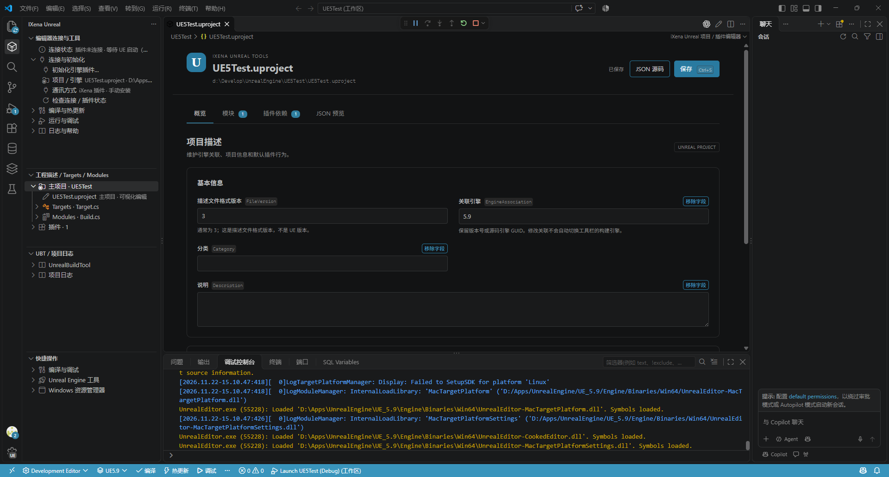
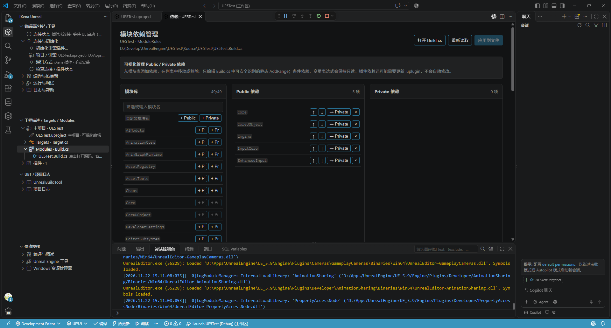
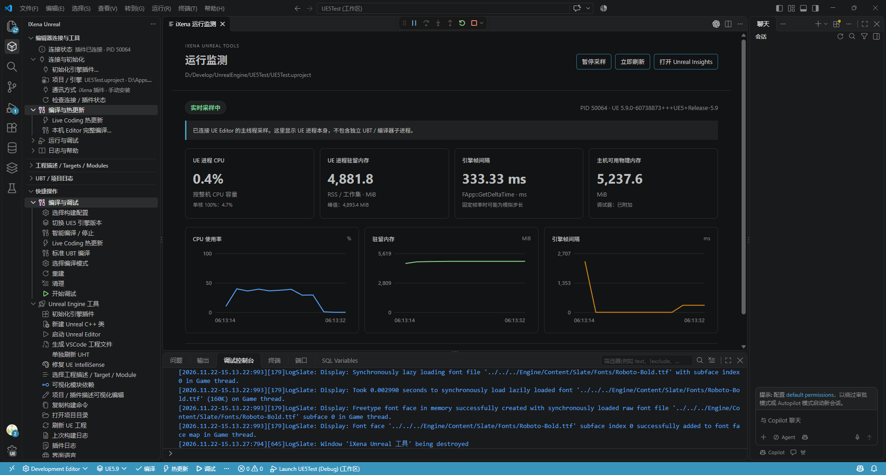

# iXenaUnrealTools

**English** · [简体中文](README.md)

iXenaUnrealTools is a toolkit for Unreal Engine 5 C++ development. It consists of a **VSCode extension** and an optional **Unreal Editor communication plugin**. It provides project builds, Live Coding, module and descriptor editing, C++ class generation, editor console commands, and performance monitoring.

- **Author:** 黄小宇
- **License:** MIT
- **Repository:** [w2zArd/iXenaUnrealTools](https://github.com/w2zArd/iXenaUnrealTools)
- **Extension ID:** `ixena-unreal-tools.ixena-unreal-tools-vscode`
- **Platforms:** The VSCode extension supports applicable desktop environments; some Windows integration features are Windows-only. The UE plugin provides source for Windows, macOS, and Linux and must be built using the matching UE toolchain.

## Screenshots







## Repository layout

```text
iXenaUnrealTools/
├── iXenaUnrealTools-VSCode/       # VSCode extension
├── iXenaUnrealTools-UnrealPlugin/ # UE plugin and build scripts
│   ├── iXenaUnrealBridge/        # Actual UE plugin directory
│   └── Tools/
├── README.md
├── README.en.md
└── LICENSE
```

## Install the VSCode extension

1. Install iXenaUnrealTools using either method:
   - **[VSCode Marketplace](https://marketplace.visualstudio.com/items?itemName=ixena-unreal-tools.ixena-unreal-tools-vscode)** (recommended): Search for `iXenaUnrealTools` in VSCode and install it directly.
   - **[GitHub Releases](https://github.com/w2zArd/iXenaUnrealTools/releases)**: Download the `.vsix` package for your preferred version, or build from source.
2. In VSCode Extensions, select **Install from VSIX** and choose the package.
3. Run `Developer: Reload Window`.
4. Open your Unreal Engine project or UE-generated `.code-workspace`, then open the **iXena Unreal** sidebar.

If an earlier extension with publisher `ixena-local` is installed, disable or uninstall it to avoid duplicate commands.

## Initialize UE communication

Open **iXena Unreal → Editor Communication → Connection & Initialization → Initialize Engine Plugin**, then choose a transport.

### Option A: iXena Unreal Bridge (recommended)

1. Download `iXenaUnrealTools-UnrealPlugin/iXenaUnrealBridge` from the repository, keeping its `.uplugin`, `Source`, `Resources`, and other files.
2. Close Unreal Editor and copy the plugin to **one** of these locations:

   - Project: `D:\Develop\UnrealEngine\UE5Test\Plugins\iXenaUnrealBridge`
   - Engine: `D:\Engines\UE_5.9\Engine\Plugins\iXena\iXenaUnrealBridge`

3. Build **Development Editor** using the matching Unreal Engine and C++ toolchain, or use the packaging scripts below.
4. Enable the plugin in **UE Plugins → iXena**, then restart Unreal Editor when prompted.
5. Select the correct project and engine in VSCode; wait for automatic reconnection or use **Check Connection / Plugin Status**.

**Important:** Initialization does not automatically download, compile, or install the plugin. Do not load two copies of the same plugin from both project and engine directories. A DLL alone is insufficient: retain the `.uplugin`, module manifests, and required files.

#### Build on Windows

Run from `iXenaUnrealTools-UnrealPlugin`:

```powershell
New-Item -ItemType Directory -Force "D:\Builds" | Out-Null
powershell.exe -NoProfile -ExecutionPolicy Bypass -File .\Tools\Build-Plugin.ps1 `
  -EngineRoot "D:\Engines\UE_5.9" `
  -Package "D:\Builds\iXenaUnrealBridge-UE5.9" `
  -Language en
```

#### Build on macOS / Linux

```bash
mkdir -p /tmp/ixena-builds
bash ./Tools/Build-Plugin.sh \
  --engine "/absolute/path/to/UE_5.x" \
  --package "/tmp/ixena-builds/iXenaUnrealBridge"
```

The scripts stream UAT/UBT output and **package only; they do not install**. With the editor closed, copy the complete output, enable the plugin, and restart the editor. The output directory must be empty or not yet exist.

### Option B: Epic Unreal MCP

Enter the MCP service endpoint in the initialization wizard:

| Setting | Example |
|---|---|
| IP / host | `127.0.0.1` |
| Port | `8000` |
| Path | `/mcp` |
| Full URL | `http://127.0.0.1:8000/mcp` |

The appropriate MCP server and toolsets must already be enabled and running in UE. Entering an address **does not enable MCP inside Unreal Editor**. Available capabilities depend on the server and its toolsets. MCP and iXena Bridge are alternative communication options.

## Features and usage

| Feature | How to use it |
|---|---|
| **Build / Stop / Debug** | Choose a UE task configuration in the status bar or sidebar, then run Build, Rebuild, Clean, Stop, or Debug; reuse UE-generated VSCode tasks/launch configurations |
| **Live Coding** | Enable Live Coding in UE Editor, keep the matching project open, and click **Live Coding**; the status updates when UE returns its final result |
| **Multiple engines** | Select a UE engine in the sidebar; switching the build toolchain does not change `.uproject` `EngineAssociation` |
| **UHT / IntelliSense** | Run the UHT and language-server refresh commands; reflection changes may still require a full build |
| **Source explorer** | Browse project and plugin sources by `Public`, `Private`, and other folders, with configurable panes |
| **`.h` ↔ `.cpp` navigation** | Right-click in an editor, tab, or file tree to open the matching file; choose manually if several candidates exist |
| **Create C++ class** | Launch the wizard from the file tree or sidebar, select parent class, module, class name and path, preview, then generate `.h/.cpp` |
| **`Build.cs` dependencies** | Open the dependency editor under Targets / Modules to edit safely recognized Public / Private module dependencies |
| **`.uproject` / `.uplugin` editing** | Select a descriptor under Targets / Modules or right-click to open its visual editor; save with `Ctrl+S` |
| **UE console commands / CVars** | Search commands in Runtime & Debugging, inspect help, enter arguments, and send to the connected UE instance |
| **CPU / memory monitoring** | View Unreal Editor process CPU, memory, frame intervals, and history; launch Unreal Insights |
| **Windows Explorer context menus** | Explicitly register or remove `.uproject` / `.uplugin` Windows context-menu entries |

### Floating panel inside Unreal Editor

After enabling `iXenaUnrealBridge`, use **iXena → Open Tools Panel** in the Unreal Editor top menu, or the toolbar entry. The panel provides command/CVar search and execution, connection status, and CPU/memory readings. The plugin category is **iXena**.

### Connection and Live Coding behavior

- VSCode automatically checks connectivity in the background and attempts to reconnect after UE restarts.
- Background checks never start Live Coding on their own.
- Success, failure, and timeout are distinct states; **a timeout does not mean UE canceled compilation**.
- Live Coding is intended primarily for supported Windows Editor environments. The plugin provides communication and other tools on macOS/Linux but not equivalent Live Coding.
- For changes to `Build.cs`, `Target.cs`, module structure, or complex reflected class layouts, close the editor and perform a full build.
- Logs reflect the output actually received; not every line from the separate Live Coding Console is guaranteed to appear in VSCode.

## Localization

Supports **Auto, Simplified Chinese, and English**.

- VSCode dynamic UI: use the **UI Language** command or set `"iXenaUnrealTools.language": "auto"` (alternatively `zh-CN` or `en`).
- VSCode static menus and command titles: follow the VSCode display language; reload when VSCode asks.
- UE floating panel: select Auto / Simplified Chinese / English independently; Auto follows the UE editor language.
- Common console commands have Chinese summaries in the Chinese UI while preserving original UE help and parameters. Unknown commands retain their original text.

## Workspace configuration example

```jsonc
{
  "folders": [
    { "name": "UE5Test", "path": "D:\\Develop\\UnrealEngine\\UE5Test" }
  ],
  "settings": {
    "iXenaUnrealTools.language": "auto",
    "iXenaUnrealTools.engineRoots": ["D:\\Engines\\UE_5.9"],
    "iXenaUnrealTools.performance.autoStartDebug": true
  }
}
```

Merge the settings into your existing `.code-workspace` as needed; do not overwrite UE-generated `tasks` or `launch` entries.

## License

MIT License. Copyright (c) 2026 黄小宇. See [LICENSE](LICENSE). Unreal Engine and third-party dependencies retain their respective licenses.
