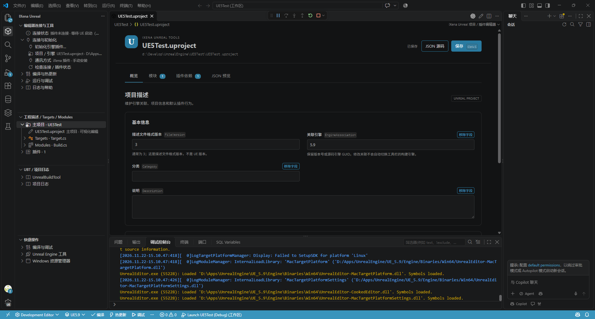
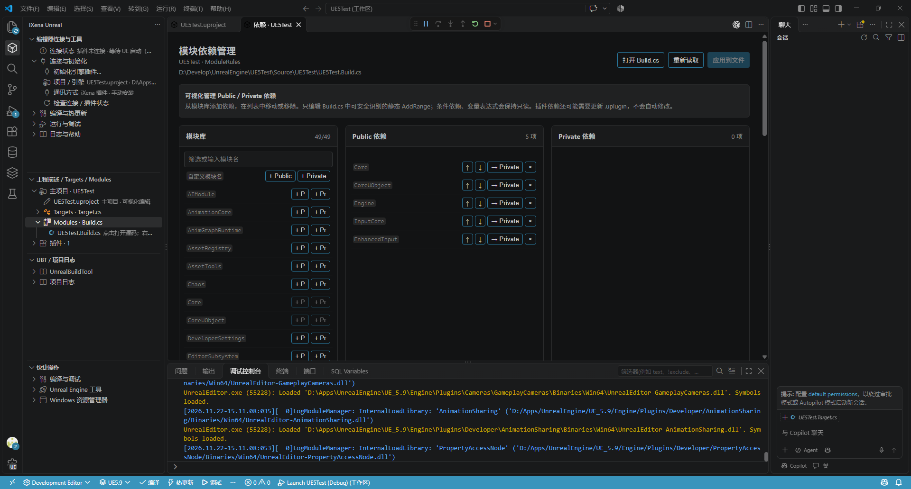
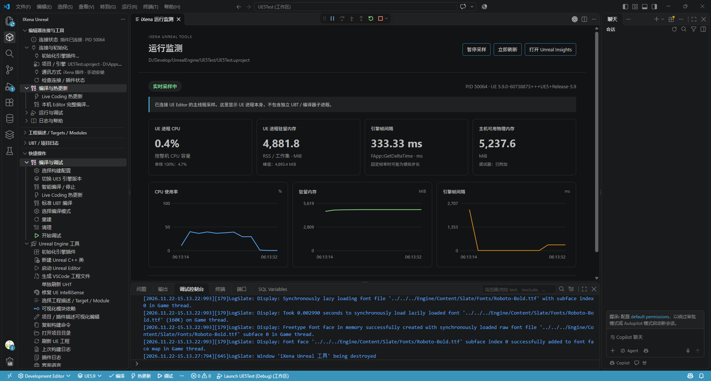

# iXenaUnrealTools

[English](README.en.md) · **简体中文**

iXenaUnrealTools 是面向 Unreal Engine 5 C++ 开发的工具集，由 **VSCode 扩展**和可选的 **Unreal Editor 通讯插件**组成。支持工程构建、Live Coding、模块与描述文件编辑、创建 C++ 类、编辑器命令和运行监测。

- **作者**：黄小宇
- **许可证**：MIT
- **源码仓库**：[w2zArd/iXenaUnrealTools](https://github.com/w2zArd/iXenaUnrealTools)
- **扩展 ID**：`ixena-unreal-tools.ixena-unreal-tools-vscode`
- **平台**：VSCode 扩展支持相应桌面环境；部分 Windows 集成功能仅限 Windows。UE 通讯插件提供 Windows、macOS、Linux 源码，实际编译需使用对应平台的 UE 工具链。

## 界面预览







## 仓库目录

```text
iXenaUnrealTools/
├── iXenaUnrealTools-VSCode/       # VSCode 扩展
├── iXenaUnrealTools-UnrealPlugin/ # UE 插件及构建脚本
│   ├── iXenaUnrealBridge/        # 实际安装到 UE 的插件目录
│   └── Tools/
├── README.md
├── README.en.md
└── LICENSE
```

## 安装 VSCode 扩展

1. 从以下任一渠道安装 iXenaUnrealTools：
   - **[VSCode Marketplace](https://marketplace.visualstudio.com/items?itemName=ixena-unreal-tools.ixena-unreal-tools-vscode)**（推荐）：直接在 VSCode 中搜索 `iXenaUnrealTools` 并安装。
   - **[GitHub Releases](https://github.com/w2zArd/iXenaUnrealTools/releases)**：下载对应版本的 `.vsix` 安装包，或从源码自行构建。
2. 在 VSCode 的扩展视图选择 **从 VSIX 安装**，选择安装包。
3. 执行 `Developer: Reload Window`。
4. 打开 Unreal Engine 项目目录或 UE 生成的 `.code-workspace`，进入 **iXena Unreal** 侧栏。

如曾安装发布者为 `ixena-local` 的测试版，建议先停用或卸载旧扩展，避免重复命令。

## 初始化 UE 通讯

在 **iXena Unreal → 编辑器通讯 → 连接与初始化** 中点击 **初始化引擎插件**，选择通讯方式。

### 方式 A：iXena Unreal Bridge（推荐）

1. 从仓库下载 `iXenaUnrealTools-UnrealPlugin/iXenaUnrealBridge`，保留 `.uplugin`、`Source`、`Resources` 等内容。
2. 关闭 Unreal Editor，将插件放到以下**任一**位置：

   - 项目安装：`D:\Develop\UnrealEngine\UE5Test\Plugins\iXenaUnrealBridge`
   - 引擎安装：`D:\Engines\UE_5.9\Engine\Plugins\iXena\iXenaUnrealBridge`

3. 使用对应 UE 引擎和 C++ 工具链编译 **Development Editor**，或使用下方脚本生成插件包。
4. 在 UE 的 **Plugins → iXena** 中启用插件，按提示重新打开编辑器。
5. 在 VSCode 选择正确的项目和引擎，等待自动连接，或点击 **检查连接 / 插件状态**。

**注意**：初始化按钮不会自动下载、编译或安装插件；同一项目不要同时从项目和引擎加载两份同名插件。不能只复制 DLL，必须保留 `.uplugin`、模块清单及必要文件。

#### Windows 手动构建

在 `iXenaUnrealTools-UnrealPlugin` 目录运行：

```powershell
New-Item -ItemType Directory -Force "D:\Builds" | Out-Null
powershell.exe -NoProfile -ExecutionPolicy Bypass -File .\Tools\Build-Plugin.ps1 `
  -EngineRoot "D:\Engines\UE_5.9" `
  -Package "D:\Builds\iXenaUnrealBridge-UE5.9" `
  -Language zh-CN
```

#### macOS / Linux 手动构建

```bash
mkdir -p /tmp/ixena-builds
bash ./Tools/Build-Plugin.sh \
  --engine "/absolute/path/to/UE_5.x" \
  --package "/tmp/ixena-builds/iXenaUnrealBridge"
```

构建脚本实时显示 UAT/UBT 输出，**只生成插件包，不会自动安装**。关闭 UE 后复制完整产物，再启用并重启编辑器。输出目录应为空或尚不存在。

### 方式 B：Epic Unreal MCP

在初始化向导中填写 MCP 服务地址：

| 设置 | 示例 |
|---|---|
| IP / 主机名 | `127.0.0.1` |
| 端口 | `8000` |
| 路径 | `/mcp` |
| 完整地址 | `http://127.0.0.1:8000/mcp` |

需要先在 UE 中启用并启动对应 MCP 服务及所需工具。填写地址**不会自动开启 UE 的 MCP**；连接能力取决于实际服务和工具集。MCP 与 iXena Bridge 是两种可选连接方式。

## 主要功能与使用方法

| 功能 | 使用方式 |
|---|---|
| **构建 / 停止 / 调试** | 从状态栏或侧栏选择 UE 任务配置，点击 Build、Rebuild、Clean、Stop 或 Debug；可复用 UE 生成的 VSCode tasks/launch |
| **Live Coding** | 在 UE Editor 中启用 Live Coding，保持匹配项目的编辑器运行，点击 **热更新**；收到 UE 最终结果后更新状态 |
| **多引擎切换** | 在侧栏选择 UE 引擎；切换构建工具链不等于修改 `.uproject` 的 `EngineAssociation` |
| **UHT / IntelliSense** | 使用独立 UHT 刷新和语言服务刷新命令；修改反射结构后可能仍需完整编译 |
| **资源管理器** | 按项目、插件、`Public`、`Private` 等目录浏览源码，可自定义分栏 |
| **`.h` ↔ `.cpp` 切换** | 在编辑器、标签页或文件树右键选择切换对应文件；多候选时手动选择 |
| **创建 C++ 类** | 在资源树右键或侧栏打开向导，选择父类、模块、类名、路径，预览并生成 `.h/.cpp` |
| **`Build.cs` 依赖** | 在 Targets / Modules 中打开依赖编辑器，编辑可安全识别的 Public / Private 模块依赖 |
| **`.uproject` / `.uplugin` 编辑** | 在 Targets / Modules 中选择文件或右键打开可视化编辑器，编辑后按 `Ctrl+S` 保存 |
| **UE 控制台命令 / CVar** | 在运行与调试面板搜索命令，查看帮助、输入参数并发送到已连接的 UE |
| **CPU / 内存监测** | 打开运行监测查看 UE Editor 进程 CPU、内存、帧间隔及历史采样；可打开 Unreal Insights |
| **Windows 文件右键菜单** | 通过扩展命令显式注册或移除 `.uproject` / `.uplugin` 系统右键菜单 |

### UE 内浮动工具面板

启用 `iXenaUnrealBridge` 后，在 Unreal Editor 顶部 **iXena → 打开工具面板**，或使用工具栏入口。可以查询命令/CVar、执行命令、查看通讯状态和 CPU/内存等指标。插件分类统一为 **iXena**。

### 通讯与热更新状态

- VSCode 在后台自动检查连接；UE 重启后会尝试恢复匹配项目的连接，无需每次手动连接。
- 自动检测只进行状态检查，不会自动启动 Live Coding。
- 热更新成功、失败和超时分别显示；**超时不代表 UE 已取消编译**。
- Live Coding 主要用于受支持的 Windows Editor 环境。macOS/Linux 可使用通讯与其他工具，但此插件不提供相同的 Live Coding 能力。
- 修改 `Build.cs`、`Target.cs`、模块结构或复杂的反射类型布局时，建议关闭 UE 后完整构建。
- 编译输出按实际可获取的数据展示；独立 Live Coding Console 的所有日志不保证全部转发到 VSCode。

## 多语言

支持 **自动跟随、简体中文、English**。

- VSCode 动态界面：使用 **界面语言** 命令，或设置 `"iXenaUnrealTools.language": "auto"`（也可设为 `zh-CN` 或 `en`）。
- VSCode 静态菜单和命令标题：跟随 VSCode 的显示语言；更改显示语言后按提示重新加载。
- UE 浮动面板：独立选择 Auto / 简体中文 / English，Auto 跟随 UE 语言。
- 中文界面为部分常用命令提供中文说明，保留 UE 原始帮助与参数文本；未收录命令保留原文。

## 工作区配置示例

```jsonc
{
  "folders": [
    { "name": "UE5Test", "path": "D:\\Develop\\UnrealEngine\\UE5Test" }
  ],
  "settings": {
    "iXenaUnrealTools.language": "auto",
    "iXenaUnrealTools.engineRoots": ["D:\\Engines\\UE_5.9"],
    "iXenaUnrealTools.performance.autoStartDebug": true
  }
}
```

此示例可按需合并到现有 `.code-workspace`；不要覆盖 UE 已生成的 `tasks` 和 `launch`。

## 许可证

MIT License。Copyright (c) 2026 黄小宇。详见 [LICENSE](LICENSE)。Unreal Engine 和第三方依赖仍遵守各自许可证。
