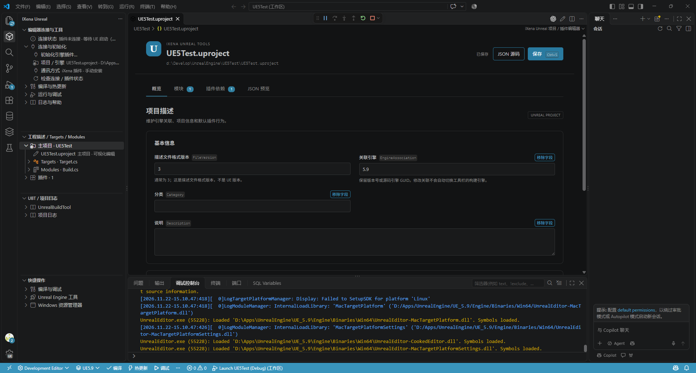
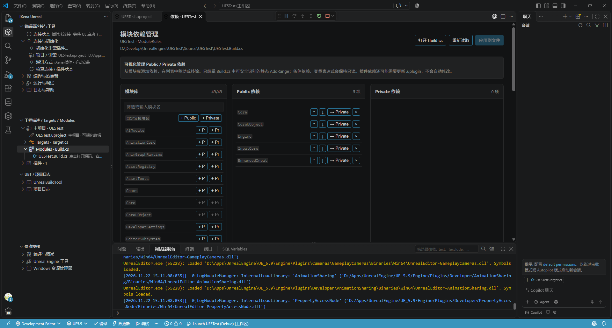
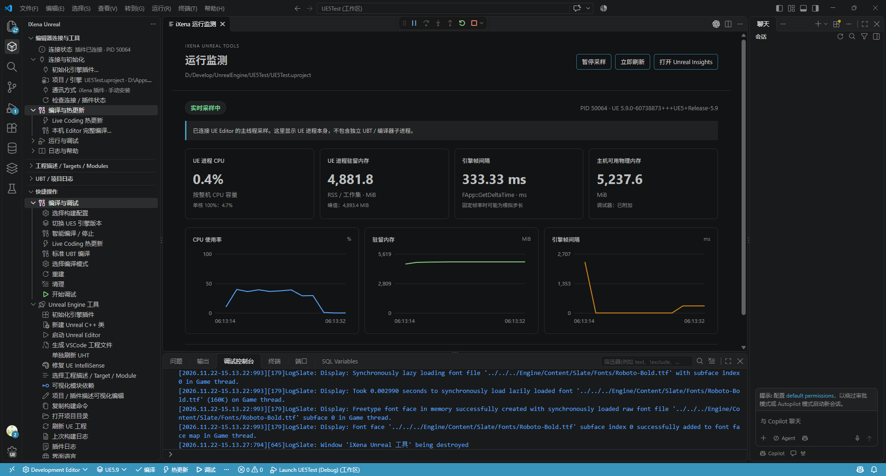

# iXena Unreal Tools for VS Code

**English** · [简体中文](README.md)

A toolkit for Unreal Engine 5 development: builds and debugging, Live Coding, engine selection, C++ class creation, module and descriptor editing, and a visual Localization Workbench.

**Author: 黄小宇** · **License: MIT** · **VS Code 1.96 or later**

- [VS Code Marketplace](https://marketplace.visualstudio.com/items?itemName=ixena-unreal-tools.ixena-unreal-tools-vscode)
- [GitHub repository](https://github.com/w2zArd/iXenaUnrealTools)
- [GitHub Releases](https://github.com/w2zArd/iXenaUnrealTools/releases)
- Extension ID: `ixena-unreal-tools.ixena-unreal-tools-vscode`

## Installation and entry points

Install from the Marketplace, or choose **Install from VSIX** in the VS Code Extensions menu and select the downloaded package. Reload the window, then open the UE-generated `.code-workspace` or the project folder containing a `.uproject`.

The **iXena Unreal** sidebar provides editor communication, localization, source panes, Targets / Modules, logs and tools. The status bar provides configuration, engine selection, build/stop and debug controls. An older installation with a different extension ID is a separate extension; disable it if duplicate controls remain.

## Localization Workbench

Open **iXena Unreal → Localization / Translations → Open Localization Workbench**. You can also right-click a `.po`, `.uproject` or `.uplugin`, or search for **iXenaUnrealTools: Localization** in the Command Palette.

| Feature | Usage |
| --- | --- |
| Automatic discovery | Opening the workbench scans workspace UE projects and their project `Plugins`, reading configurations in `Config/Localization` and PO catalogs in `Content/Localization`; file changes refresh discovery |
| Target and culture selection | Choose a project/plugin target and a culture such as `en`, `zh-Hans` or `ja` |
| Translation table | Inspect identity, source, translations, plural forms, references and comments; edit translations directly |
| Search and filters | Search source, translations, identities and references in the selected target/culture; filter untranslated, review-needed and modified rows |
| Progress and checks | View total, translated, untranslated and review counts; inspect fuzzy flags, `{Name}` format arguments and line-break differences |
| Import | Import PO or the extension's CSV / JSON format; exact identity, source and plural matching prevents unrelated edits; confirm match counts before applying |
| Export | Export the selected culture or all cultures of the selected target to PO / CSV / JSON, independently of table filters and pagination |
| Automatic export | Enable export on save to create separate copies in all three formats when a discovered PO is saved |
| UE operations | Run Gather & Export, Import & Compile, individual steps or open their configuration INI files |
| Drafts and conflicts | Preserve drafts in the workspace; detect external revisions; save or discard changes before switching targets |

The workbench invokes the selected engine's Commandlet directly. **It requires neither iXena Unreal Bridge nor MCP.** Existing PO files can be browsed, edited and exported without running UE. Collecting asset text and importing/compiling localization resources requires a runnable matching UE Editor installation.

### Existing UE Localization Dashboard targets

1. Set up the target and cultures in UE. Run the Gather, Export, Import and Compile actions you need to generate the corresponding `Config/Localization/*.ini` files.
2. Scan in VS Code and select a target and culture.
3. Use **Gather & Export** to collect new text.
4. Edit translations and click **Save translations**, or press `Ctrl+S` / `⌘+S`.
5. Use **Import & Compile** to import the translations and generate `.locres` files through UE.

Existing targets retain their configurations. Add cultures to Dashboard-owned targets in UE, regenerate the configurations and rescan. Dashboard target settings and Commandlet INI files use different configuration structures; editing an INI does not update Dashboard settings.

### Creating a target from VS Code

1. Click **New target** and select the project or a project plugin.
2. Enter a target name such as `Game` and a native culture matching your source text, such as `en`.
3. Enter target cultures, for example `en,zh-Hans,ja`.
4. Run **Gather & Export**, then edit and save translations.
5. Use **Add culture** for additional cultures, then gather and export again.

The extension creates independent `Config/Localization/iXena.<target>.<operation>.ini` files and `<target>.ixena-loc.json` in the selected scope. You can edit the INI files directly; UE still performs the operations. These targets are not automatically registered in the UE Dashboard. Keep one configuration owner for each localization data set.

Configure runtime loading paths for project targets, or `LocalizationTargets` / LoadingPolicy for plugin targets. Also configure **Localizations to Package** and **Internationalization Support** for packaging. Generating `.locres` does not configure its runtime loading automatically.

### Automatic export and logs

Enable the workbench checkbox, or merge this setting into your workspace:

```jsonc
{
  "settings": {
    "iXenaUnrealTools.localization.autoExportOnSave": true
  }
}
```

The extension writes `.po`, `.csv` and `.json` copies to `Saved/iXenaUnrealTools/LocalizationExports/<scope>/<target>-<identity>/<culture>/`. A target identity suffix prevents collisions between equally named projects or plugins. This setting does not automatically gather, compile or machine-translate text.

Commandlet output appears live in the existing task terminal. Stop first sends Ctrl+C. Each run keeps separate logs and pre-operation PO copies in `Saved/iXenaUnrealTools/LocalizationRuns/`. A failed step prevents later steps from running; existing PO translations are included in the import workflow before an export can overwrite them.

### Text and format scope

- UE GatherText collects new text from configured `LOCTEXT` / `NSLOCTEXT`, localizable `FText` and asset sources. Ordinary `FString`, hardcoded UI strings and non-localizable text are not automatically converted into translatable text.
- Discovery covers workspace projects and their project plugins, not the entire engine, engine plugins or directories linked outside the project. Unsupported paths and ambiguous configurations produce notices.
- PO is UE's translation exchange format. CSV / JSON use the extension's lossless interchange schema; import them into the extension, then run UE Import/Compile.
- UTF-8 PO supports BOM, CRLF, escapes, multiline entries, plurals and comments. Crowdin identity-format catalogs are shown read-only; open the original PO to edit those.
- The workbench manages text translations. It does not replace localized audio, dialogue import, localized asset replacement or regional date/number formatting, and does not call machine translation services.

## Other development tools

| Feature | Usage |
| --- | --- |
| Build / stop / debug | Read existing workspace tasks and launch configurations; choose a configuration and reuse the project's task terminal |
| Multiple engines | Select an engine in the status bar; configure roots with `iXenaUnrealTools.engineRoots` |
| UHT / IntelliSense | Refresh UHT and language services separately; use a full build when module or reflection changes require it |
| C++ class wizard | Create a class from the panel or context menu; choose parent, module, Public/Private and subdirectory; generated headers have Chinese comments |
| Header/source switching | Switch paired `.h/.cpp` files from the editor or resource tree |
| Source panes | Configure `iXenaUnrealTools.explorer.panes` or compatible `multiExplorer.panes` to browse project/plugin Public, Private and other folders |
| Module dependencies | Visually edit recognized static Public/Private Build.cs dependencies; retain manual editing for complex conditional C# |
| Descriptors | Visually edit `.uproject` / `.uplugin` while preserving unknown fields; open the underlying JSON when needed |
| Editor communication | Optional iXena Bridge or Epic Unreal MCP for Live Coding, connection state and logs |
| Commands and performance | Search registered UE commands/CVars, inspect help and send commands; inspect CPU/memory and open Unreal Insights |
| Windows context menus | Explicitly register/remove current-user `.uproject` / `.uplugin` Explorer commands |

## Optional UE communication plugin

Choose a transport using **Initialize Engine Plugin**. Plugin mode opens the repository. Download `iXenaUnrealTools-UnrealPlugin/iXenaUnrealBridge`, close UE and copy it to one location:

- Project: `D:\Develop\UnrealEngine\UE5Test\Plugins\iXenaUnrealBridge`
- Engine: `D:\Engines\UE_5.9\Engine\Plugins\iXena\iXenaUnrealBridge`

Build with the matching engine's C++ toolchain, or package with the Windows / macOS / Linux scripts under `iXenaUnrealTools-UnrealPlugin/Tools`. Enable it in **UE Plugins → iXena** and reopen UE. Keep the complete plugin directory and metadata. The initialization command does not automatically download or install it.

For MCP, enter the IP, port and path of an enabled service. The default example is `127.0.0.1:8000/mcp`; service capabilities depend on the engine and enabled toolsets. Live Coding availability depends on the engine/platform. Localization Commandlet launching independently supports Windows, macOS and Linux editor paths.

## Workspace settings

Merge into the existing `.code-workspace`, keeping its tasks and launch configurations:

```jsonc
{
  "folders": [
    { "name": "UE5Test", "path": "D:\\Develop\\UnrealEngine\\UE5Test" }
  ],
  "settings": {
    "iXenaUnrealTools.language": "auto",
    "iXenaUnrealTools.engineRoots": ["D:\\Engines\\UE_5.9"],
    "iXenaUnrealTools.localization.autoExportOnSave": true,
    "iXenaUnrealTools.explorer.panes": [
      { "label": "Public", "roots": ["${workspaceFolder:UE5Test}/Source/UE5Test/Public"] },
      { "label": "Private", "roots": ["${workspaceFolder:UE5Test}/Source/UE5Test/Private"] }
    ]
  }
}
```

Dynamic interfaces support `auto`, `zh-CN` and `en`. Static command titles and context menus follow the VS Code display language. Identifiers, user data and engine logs retain their original text.

## Screenshots







## Building from source

Run inside `iXenaUnrealTools-VSCode`:

```bash
npm ci
npm run compile
npm run package
```

Source and software are distributed under [MIT](LICENSE). Unreal Engine and other dependencies retain their own licenses.
