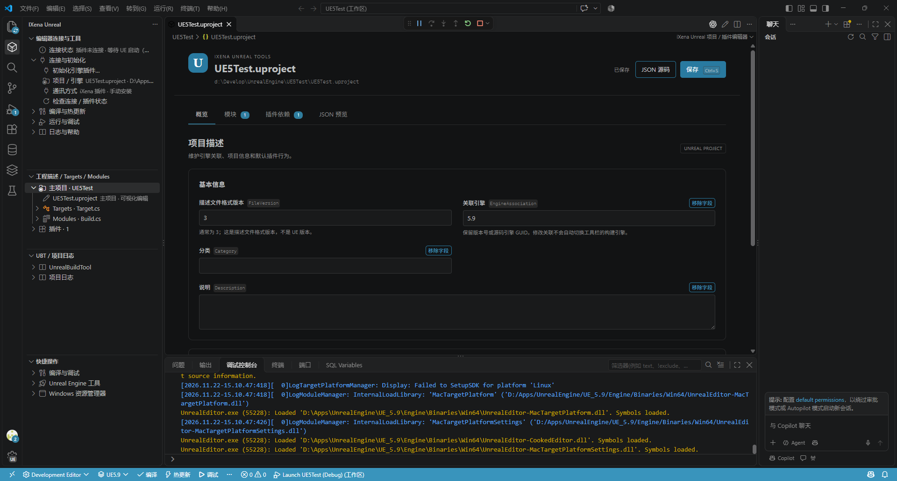
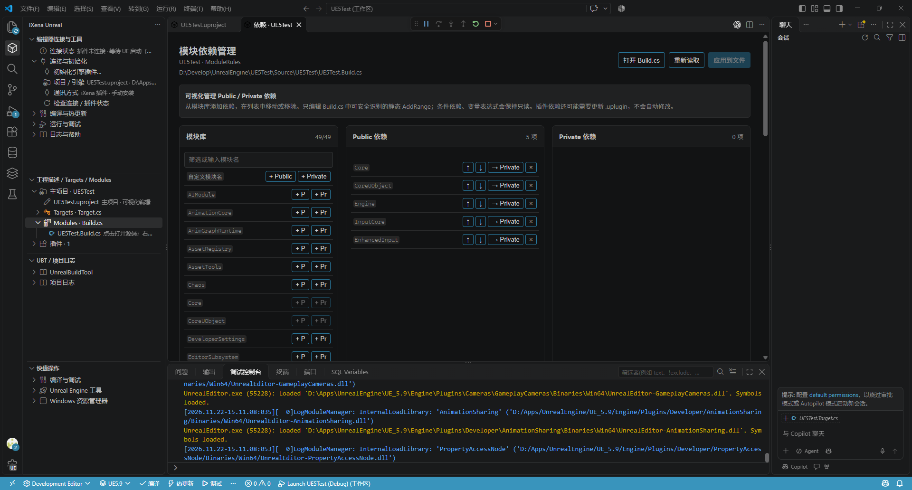
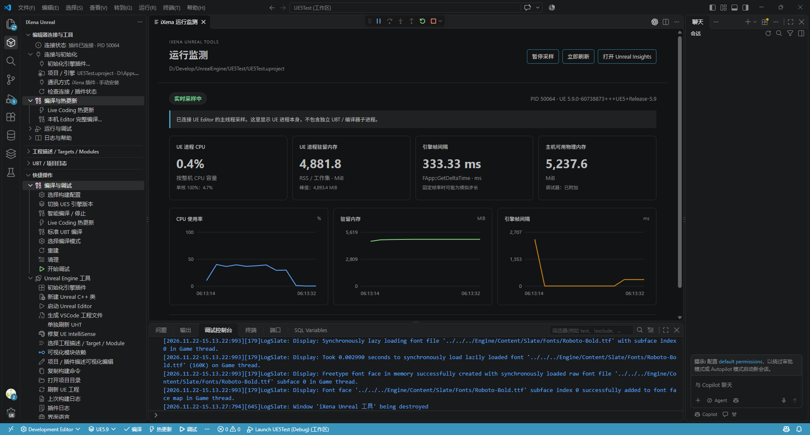

# iXena Unreal Tools for VS Code

**简体中文** · [English](README.en.md)

Unreal Engine 5 开发工具箱：构建与调试、Live Coding、多引擎切换、C++ 类向导、模块与描述文件编辑，以及可视化本地化工作台。

**作者：黄小宇** · **许可证：MIT** · **VS Code 1.96 或更高版本**

- [VS Code Marketplace](https://marketplace.visualstudio.com/items?itemName=ixena-unreal-tools.ixena-unreal-tools-vscode)
- [GitHub 仓库](https://github.com/w2zArd/iXenaUnrealTools)
- [GitHub Releases](https://github.com/w2zArd/iXenaUnrealTools/releases)
- 扩展 ID：`ixena-unreal-tools.ixena-unreal-tools-vscode`

## 安装与入口

从 Marketplace 安装，或在 VS Code 扩展视图的菜单中选择 **从 VSIX 安装**，选中下载的安装包，然后重新加载窗口。打开 UE 生成的 `.code-workspace` 或包含 `.uproject` 的项目目录。

左侧 **iXena Unreal** 提供编辑器通讯、本地化、源码分栏、Targets / Modules、日志和工具入口。状态栏提供构建配置、引擎、构建/停止与调试。旧扩展 ID 的安装不属于同一个扩展；如果仍有重复的按钮，请停用旧扩展。

## 本地化工作台

进入 **iXena Unreal → 本地化 / 翻译 → 打开本地化工作台**。也可以右键 `.po`、`.uproject`、`.uplugin`，或者在命令面板搜索 **iXenaUnrealTools: 本地化**。

| 功能 | 用法 |
| --- | --- |
| 自动发现 | 打开工作台时扫描当前工作区 UE 项目及其 `Plugins` 下的目标；识别 `Config/Localization` 中的配置和 `Content/Localization` 下的 PO，文件变化后刷新 |
| 目标与语言选择 | 按主项目或项目插件选择目标，再切换 `en`、`zh-Hans`、`ja` 等语言 |
| 翻译表格 | 查看文本身份、源文、译文、复数形式、源文件引用和注释；直接编辑译文 |
| 搜索与筛选 | 搜索当前目标、当前语言的原文、译文、身份和引用；筛选未翻译、需复核、本次修改 |
| 进度与检查 | 显示总数、已翻译、未翻译、需复核数量；提示 fuzzy 标记、`{Name}` 格式参数和换行差异 |
| 导入 | 导入 PO 或本扩展导出的 CSV / JSON；按相同身份、源文和复数信息匹配，预览匹配数量后应用 |
| 导出 | 导出当前语言，或勾选“所有语言”导出当前目标的全部 PO / CSV / JSON；导出不受表格搜索、筛选或分页影响 |
| 自动导出 | 启用“保存后自动导出”，保存已发现的 PO 时生成三种格式的独立副本 |
| UE 流程 | 执行采集并导出、导入并编译，或展开高级选项单独执行步骤、打开 INI |
| 草稿与冲突 | 草稿在工作区中保留；检测外部版本变化，保护磁盘译文；未保存时先保存或放弃再切换目标 |

本地化工作台直接使用选定引擎的 Commandlet，**不需要安装 iXena Unreal Bridge，也不需要开启 MCP**。离线查看、编辑和导出已有 PO 无需启动 UE；采集蓝图、UMG、地图、字符串表资产，以及导入/编译资源，需要可运行的对应 UE Editor 引擎。

### 已经使用 UE Localization Dashboard

1. 在 UE 中设置目标与文化，并执行所需的 Gather、Export、Import、Compile 操作，以生成对应的 `Config/Localization/*.ini`。
2. 打开 VS Code 工作台并扫描，选择目标和语言。
3. 点击 **采集并导出** 获取新增文本。
4. 修改译文后点击 **保存翻译**，或使用 `Ctrl+S` / `⌘+S`。
5. 点击 **导入并编译**，由 UE 导入译文并生成 `.locres`。

已有目标保持原配置。添加语言请在 UE Dashboard 中完成并重新生成配置，再回到 VS Code 刷新。Dashboard 设置与 Commandlet INI 是两种配置结构；直接改 INI 不会同步改变 Dashboard。

### 从 VS Code 新建目标

1. 点击 **新建目标**，选择主项目或项目插件。
2. 输入目标名，例如 `Game`；指定与源文一致的源语言，例如 `en`。
3. 输入目标语言，例如 `en,zh-Hans,ja`。
4. 点击 **采集并导出**，然后编辑并保存译文。
5. 使用 **添加语言** 扩充此目标的语言，再次采集并导出。

扩展在选定范围内创建独立的 `Config/Localization/iXena.<目标>.<操作>.ini` 和 `<目标>.ixena-loc.json`。配置可直接在源码视图调整；每次操作仍交给 UE 执行。该目标不会自动登记到 UE Dashboard。不要为同一份本地化数据建立两个配置所有者。

新建项目目标还需要设置本地化加载路径；插件目标需要相应的 `LocalizationTargets` / LoadingPolicy。最终打包还需要配置 **Localizations to Package** 与 **Internationalization Support**。生成 `.locres` 和让游戏加载该资源是两个步骤。

### 自动导出与日志

在工作台勾选自动导出，或合并下面的设置：

```jsonc
{
  "settings": {
    "iXenaUnrealTools.localization.autoExportOnSave": true
  }
}
```

副本写入项目下的 `Saved/iXenaUnrealTools/LocalizationExports/<范围>/<目标>-<标识>/<语言>/`，包括 `.po`、`.csv`、`.json`。导出目录包含目标标识，避免同名项目或插件互相覆盖。此开关不会后台自动采集、编译或翻译。

Commandlet 实时输出复用现有任务终端；点击停止优先发送 Ctrl+C。每次操作的独立日志和操作前 PO 副本保存在 `Saved/iXenaUnrealTools/LocalizationRuns/`。任一步骤失败后不执行后续步骤；已有 PO 会先被纳入导入流程，避免导出覆盖尚未导入的译文。

### 文本与格式范围

- 新文本由 UE GatherText 收集，覆盖配置范围内的 `LOCTEXT` / `NSLOCTEXT`、可本地化 `FText` 与资产文本。普通 `FString`、硬编码 UI 文本、关闭本地化的文本不会因此自动变成可翻译文本。
- 自动发现范围是工作区项目及其项目插件；不会递归扫描整套引擎、Engine 插件或链接到项目外的目录。特殊路径、混合流程和歧义配置会显示提示。
- PO 是 UE 的标准翻译交换格式。CSV / JSON 使用扩展自己的无损交换结构，导回本扩展后再通过 UE Import/Compile 生效。
- UTF-8 PO 支持 BOM、CRLF、转义、多行、复数和注释。Crowdin 身份格式先按只读展示，可打开原始 PO 编辑。
- 此工作台管理文本翻译，不替代本地化音频、配音导入、资产替换和区域化日期/数字功能，也不调用机器翻译服务。

## 其他开发功能

| 功能 | 用法 |
| --- | --- |
| 构建 / 停止 / 调试 | 读取已有 workspace tasks 和 launch；选择配置后构建或调试；同一项目复用任务终端 |
| 多引擎切换 | 使用状态栏引擎选择；可在 `iXenaUnrealTools.engineRoots` 配置多个引擎 |
| UHT / IntelliSense | 单独刷新 UHT 与语言服务；模块或反射结构变动后按需完整构建 |
| C++ 类向导 | 从面板或右键创建类，选择父类、模块、Public/Private 和子目录，生成带中文注释的头文件 |
| `.h/.cpp` 切换 | 通过资源树或编辑器右键切换同一模块中的配对文件 |
| 源码分栏 | 配置 `iXenaUnrealTools.explorer.panes` 或兼容的 `multiExplorer.panes`，按主项目/插件浏览 Public、Private 等目录 |
| 模块依赖 | 可视化编辑 Build.cs 中可识别的静态 Public/Private 依赖，复杂 C# 条件代码保留手工修改 |
| 描述文件 | 可视化编辑 `.uproject` / `.uplugin`，保留未知字段并支持源码视图 |
| 编辑器通讯 | 可选 iXena Bridge 或 Epic Unreal MCP，支持 Live Coding、连接状态与日志 |
| 命令与性能 | 搜索 UE 注册的命令/CVar、查看帮助并发送；查看 CPU/内存和打开 Unreal Insights |
| Windows 系统菜单 | 显式注册或移除 `.uproject` / `.uplugin` 的当前用户右键菜单 |

## 可选的 UE 通讯插件

点击 **初始化引擎插件** 选择通讯方式。插件方式打开仓库，下载 `iXenaUnrealTools-UnrealPlugin/iXenaUnrealBridge`，关闭 UE 后放入以下任一目录：

- 项目：`D:\Develop\UnrealEngine\UE5Test\Plugins\iXenaUnrealBridge`
- 引擎：`D:\Engines\UE_5.9\Engine\Plugins\iXena\iXenaUnrealBridge`

使用匹配引擎的 C++ 工具链构建，或使用 `iXenaUnrealTools-UnrealPlugin/Tools` 中的 Windows / macOS / Linux 脚本打包，然后在 **UE Plugins → iXena** 中启用并重开 UE。保留完整插件目录和元数据。初始化入口本身不自动下载或安装。

MCP 方式填写已启用服务的 IP、端口和路径。默认示例为 `127.0.0.1:8000/mcp`；服务能力由 UE 版本和所启用的工具集决定。Live Coding 的平台能力与对应引擎一致；本地化 Commandlet 入口独立支持 Windows、macOS、Linux 的编辑器路径。

## 工作区设置示例

合并到现有 `.code-workspace`，保留原有 tasks 与 launch：

```jsonc
{
  "folders": [
    { "name": "UE5Test", "path": "D:\\Develop\\UnrealEngine\\UE5Test" }
  ],
  "settings": {
    "iXenaUnrealTools.language": "auto",
    "iXenaUnrealTools.engineRoots": ["D:\\Engines\\UE_5.9"],
    "iXenaUnrealTools.localization.autoExportOnSave": true,
    "iXenaUnrealTools.explorer.panes": [
      { "label": "Public", "roots": ["${workspaceFolder:UE5Test}/Source/UE5Test/Public"] },
      { "label": "Private", "roots": ["${workspaceFolder:UE5Test}/Source/UE5Test/Private"] }
    ]
  }
}
```

动态界面支持 `auto`、`zh-CN` 和 `en`。命令标题与右键菜单跟随 VS Code 显示语言；原始标识符、用户数据和引擎日志保留原文。

## 预览







## 从源码构建

在 `iXenaUnrealTools-VSCode` 目录运行：

```bash
npm ci
npm run compile
npm run package
```

源码和软件采用 [MIT](LICENSE) 许可证。Unreal Engine 及其他依赖适用各自许可。
